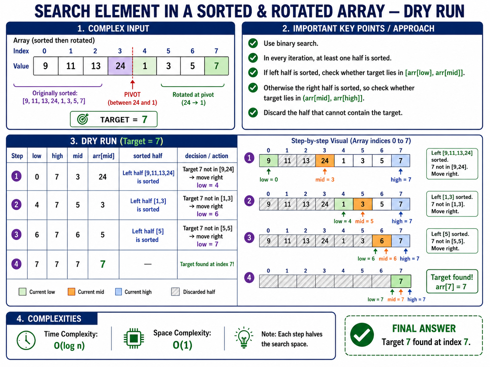
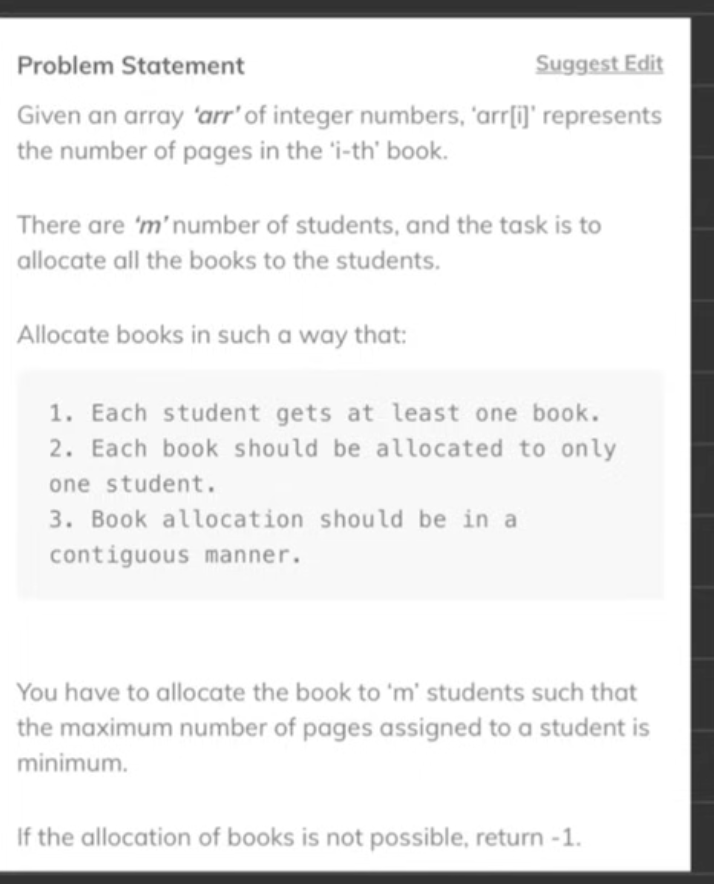
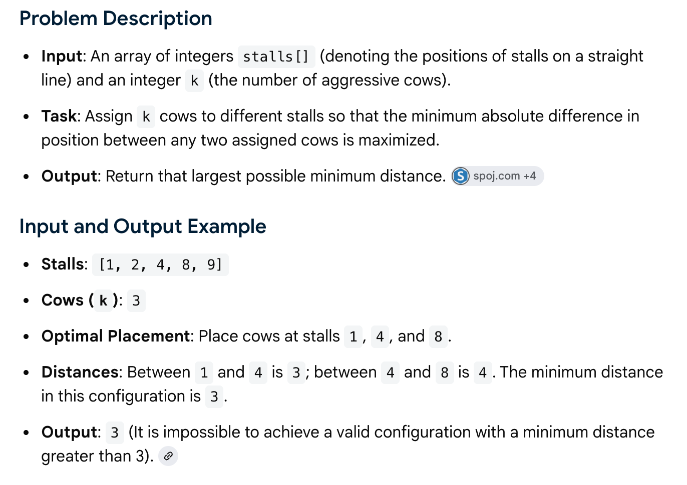

# Binary Search Problems

- Style A: The "Exact Target / Match" Style, Code: while low <= high (Striver's Binary Search Vidoes)
- Style B: The "Property / Convergence" Style, Code: while low < high (Codestory mik)

---

## 1. Lower and Upper Bound

[Lower Bound — GFG](https://www.geeksforgeeks.org/problems/implement-lower-bound/1) · [Upper Bound — GFG](https://www.geeksforgeeks.org/problems/implement-upper-bound/1)

**Core Trick**: Lower bound: arr[mid] >= target, Upper bound: arr[mid] > target

```java
class Solution {
    public int lower_bound(int[] arr, int target) {
        int low = 0;
        int ans = arr.length;
        int high = arr.length - 1;

        while (low <= high) {
            int mid = low + (high - low) / 2;

            // If mid element is greater than or equal to target
            if (arr[mid] >= target) {
                ans = mid;
                high = mid - 1; // Look left; mid is still a candidate
            } else {
                low = mid + 1; // Look right; mid is too small
            }
        }
        return ans;
    }

    public int upper_bound(int[] arr, int target) {
        int low = 0;
        int ans = arr.length;
        int high = arr.length - 1;

        while (low <= high) {
            int mid = low + (high - low) / 2;

            // If mid element is strictly greater than target
            if (arr[mid] > target) {
                ans = mid;
                high = mid - 1; // Look left; mid is still a candidate
            } else {
                low = mid + 1; // Look right; mid is <= target, so discard it
            }
        }
        return ans;
    }
}
```

---

## 2. Search in an Infinitely Long Sorted Array

[GeeksforGeeks](https://www.geeksforgeeks.org/dsa/find-position-element-sorted-array-infinite-numbers/)

It first expands the search range exponentially and then applies binary search.

```java
class Solution {
    public int find_element_infinite_array(int[] arr, int target) {
        if (arr.length == 0) return -1;
        // Phase 1: Exponential Backoff to find the search window
        int low = 0;
        int high = Math.min(1, arr.length - 1);

        // Expand high exponentially until arr[high] is >= target
        while (high < arr.length - 1 && arr[high] < target) {
            low = high;
            // Double the search space window; cap it for a finite Java array.
            high = (int) Math.min(2L * high, arr.length - 1L);
        }

        // Phase 2: Standard Binary Search within the discovered window [low, high]
        while (low <= high) {
            int mid = low + (high - low) / 2;

            if (arr[mid] == target) {
                return mid; // Target found, return its index
            } else if (arr[mid] > target) {
                high = mid - 1; // Look left
            } else {
                low = mid + 1; // Look right
            }
        }
        return -1; // Target is not present in the array
    }
}
```

---

## 3. The N-th Root of an Integer

[GeeksforGeeks](https://www.geeksforgeeks.org/problems/nth-root-of-m5843/1)

> **Core Trick**: In binary search on answer, you have to define left and right. It's usually on 1 to m.

```java
class Solution {
    /*
    Helper function to calculate number^n safely.
    Returns:
     1 if number^n > target
     0 if number^n == target
    -1 if number^n < target
    */
    private int multiply(int number, int n, int target) {
        long ans = 1;
        for (int i = 0; i < n; i++) {
            ans *= number;
            if (ans > target) {
                return 1; // Exceeded target early, prevent unnecessary loops
            }
        }
        if (ans == target) return 0;
        return -1;
    }

    public int nth_root(int n, int m) {
        if (m == 0) return 0;
        // Search space for the root is always between 1 and M
        int low = 1;
        int high = m;

        while (low <= high) {
            int mid = low + (high - low) / 2;
            int mid_power_status = multiply(mid, n, m);

            if (mid_power_status == 0) {
                return mid; // Exact N-th root found
            } else if (mid_power_status == 1) {
                high = mid - 1; // mid^N is too big, search left
            } else {
                low = mid + 1; // mid^N is too small, search right
            }
        }
        return -1; // Return -1 if M is not a perfect N-th power
    }
}
```

---

## 4. Square Root of an Integer

[LeetCode 69](https://leetcode.com/problems/sqrtx/)

**Core Trick:** Finding the Square Root of an Integer \(M\) is a specific case of the \(N\)-th root problem where \(N = 2\). If perfect square is not found then we look for floor value.

```java
class Solution {
    public int floor_sqrt(int m) {
        // Edge case for 0 and 1
        if (m == 0 || m == 1) return m;

        int low = 1;
        int high = m;
        int ans = 0; // To track the closest floor square root

        while (low <= high) {
            int mid = low + (high - low) / 2;
            long mid_squared = (long) mid * mid;

            if (mid_squared == m) {
                return mid; // Exact perfect square found
            } else if (mid_squared < m) {
                ans = mid; // mid is a potential floor answer, save it
                low = mid + 1; // Try to find a larger value on the right
            } else {
                high = mid - 1; // Too big, look left
            }
        }
        return ans;
    }
}
```

---

## 5. Search in a Sorted and Rotated Array

[LeetCode 33](https://leetcode.com/problems/search-in-rotated-sorted-array/) · [Rotated II — LeetCode 81](https://leetcode.com/problems/search-in-rotated-sorted-array-ii/)



> **Core Trick**: Identify which half is sorted: left/right.

```java
class Solution {
    public int search_rotated_sorted_array(int[] arr, int target) {
        int low = 0;
        int high = arr.length - 1;

        while (low <= high) {
            int mid = low + (high - low) / 2;

            // Condition 1: Target found
            if (arr[mid] == target) return mid;

            // Condition 2: Left half is normally sorted
            if (arr[low] <= arr[mid]) {
                // Check if target falls strictly within this left sorted range
                if (arr[low] <= target && target < arr[mid]) {
                    high = mid - 1; // Search left
                } else {
                    low = mid + 1; // Search right
                }
            } else {
                // Condition 3: Right half is normally sorted
                // Check if target falls strictly within this right sorted range
                if (arr[mid] < target && target <= arr[high]) {
                    low = mid + 1; // Search right
                } else {
                    high = mid - 1; // Search left
                }
            }
        }
        return -1; // Target not found
    }

    public boolean search_rotated_sorted_array_ii(int[] arr, int target) {
        int low = 0, high = arr.length - 1;
        while (low <= high) {
            int mid = low + (high - low) / 2;
            if (arr[mid] == target) return true;

            // Rotated II - Critical Edge Case: Cannot determine which half is sorted
            if (arr[low] == arr[mid] && arr[mid] == arr[high]) {
                low++;
                high--;
                continue; // Skip to the next iteration with reduced search space
            }
            if (arr[low] <= arr[mid]) {
                if (arr[low] <= target && target < arr[mid]) high = mid - 1;
                else low = mid + 1;
            } else {
                if (arr[mid] < target && target <= arr[high]) low = mid + 1;
                else high = mid - 1;
            }
        }
        return false;
    }
}
```

---

## 6. Find Peak Element

[LeetCode 162](https://leetcode.com/problems/find-peak-element/)

Question: A peak element in an array is an element that is strictly greater than its **neighbors**.
If **multiple peaks** then return any of them. If peak at **either side** then assume the out-of-bounds neighbors are equal to negative infinity (-∞).

```java
class Solution {
    public int find_peak_element(int[] arr) {
        int n = arr.length;

        // Handle single element edge case
        if (n == 1) return 0;

        // Check if the first or last element is a peak
        if (arr[0] > arr[1]) return 0;
        if (arr[n - 1] > arr[n - 2]) return n - 1;

        // Search space excludes the first and last elements since they were already checked
        int low = 1;
        int high = n - 2;

        while (low <= high) {
            int mid = low + (high - low) / 2;

            // Condition 1: mid is a peak element
            if (arr[mid] > arr[mid - 1] && arr[mid] > arr[mid + 1]) {
                return mid;
            } else if (arr[mid] < arr[mid + 1]) {
                // Condition 2: We are on an upward slope to the right
                low = mid + 1; // A peak must exist to the right
            } else {
                // Condition 3: We are on a downward slope, or a local valley
                high = mid - 1; // A peak must exist to the left
            }
        }
        return -1;
    }
}
```

Style B: Instead of looking at both neighbors, you only look at one anchor: the neighbor directly to the right (nums[mid + 1]). This tells you which direction the mountain slope is going.Because low < high, mid can never equal high. This guarantees that mid + 1 is always a valid index inside the array. It will never crash.

```java
class Solution {
    public int find_peak_element(int[] nums) {
        int low = 0;
        int high = nums.length - 1;

        while (low < high) {
            int mid = low + (high - low) / 2;

            // Compare mid with its immediate right neighbor
            if (nums[mid] < nums[mid + 1]) {
                low = mid + 1; // Upward slope: peak is to the right
            } else {
                high = mid; // Downward slope: mid or left could be peak
            }
        }
        return low; // low and high converge perfectly on a peak
    }
}
```

---

## 7. Find First and Last Position

[LeetCode 34](https://leetcode.com/problems/find-first-and-last-position-of-element-in-sorted-array/)

```java
class Solution {
    private int find_first_occurrence(int[] arr, int target) {
        int low = 0;
        int high = arr.length - 1;
        int first_idx = -1;

        while (low <= high) {
            int mid = low + (high - low) / 2;

            if (arr[mid] == target) {
                first_idx = mid;
                high = mid - 1; // Keep looking left for the first occurrence
            } else if (arr[mid] < target) {
                low = mid + 1;
            } else {
                high = mid - 1;
            }
        }
        return first_idx;
    }

    private int find_last_occurrence(int[] arr, int target) {
        int low = 0;
        int high = arr.length - 1;
        int last_idx = -1;

        while (low <= high) {
            int mid = low + (high - low) / 2;

            if (arr[mid] == target) {
                last_idx = mid;
                low = mid + 1; // Keep looking right for the last occurrence
            } else if (arr[mid] < target) {
                low = mid + 1;
            } else {
                high = mid - 1;
            }
        }
        return last_idx;
    }

    /*
    Returns a list/tuple of [first_occurrence, last_occurrence].
    Returns [-1, -1] if the target is not found.
    */
    public int[] first_and_last_position(int[] arr, int target) {
        int first = find_first_occurrence(arr, target);
        // If the first occurrence doesn't exist, the last won't either
        if (first == -1) return new int[]{-1, -1};

        int last = find_last_occurrence(arr, target);
        return new int[]{first, last};
    }
}
```

---

## 8. Find Minimum in a Rotated Sorted Array

[LeetCode 153](https://leetcode.com/problems/find-minimum-in-rotated-sorted-array/) · [With Duplicates — LeetCode 154](https://leetcode.com/problems/find-minimum-in-rotated-sorted-array-ii/)

Style B: This version also handles duplicate values. With distinct values, the time complexity is `O(log n)`. With many duplicates, the worst case can become `O(n)`. Pointer-Convergence Style:

```java
class Solution {
    public int findMin(int[] nums) {
        int low = 0;
        int high = nums.length - 1;

        // Step 3: Continue until one minimum candidate remains.
        while (low < high) {
            int mid = low + (high - low) / 2;

            // Step 5: If nums[mid] is smaller than nums[high],the minimum is at mid or somewhere to its left.
            if (nums[mid] < nums[high]) {
                high = mid;
            } else if (nums[mid] > nums[high]) {
                low = mid + 1;
            } else {
                // Step 7: Equal values do not reveal the correct half.
                // Remove one duplicate safely from the right.
                high--;
            }
        }
        // Step 8: low points to the minimum element.
        return nums[low];
    }
}
```

---

## 9. Koko Eating Bananas

[LeetCode 875](https://leetcode.com/problems/koko-eating-bananas/)

```java
class Solution {
    public int minEatingSpeed(int[] piles, int h) {
        // Step 1: Define the search space for speed 'k'
        int low = 1;
        int high = 0;
        for (int pile : piles) high = Math.max(high, pile);
        int ans = high; // Fallback answer tracking variable

        while (low <= high) {
            int mid_speed = low + (high - low) / 2;

            // Calculate total hours spent eating at 'mid_speed'
            long total_hours = 0;
            for (int pile : piles) {
                total_hours += (pile + (long) mid_speed - 1) / mid_speed;
            }

            // Condition Check
            if (total_hours <= h) {
                ans = mid_speed; // mid_speed works! Save it as a candidate.
                high = mid_speed - 1; // Try to find a slower, more optimal speed.
            } else {
                low = mid_speed + 1; // Too slow, Koko runs out of time. Look right.
            }
        }
        return ans;
    }
}
```

---

## 10. Allocation of Minimum Number of Pages

[GeeksforGeeks](https://www.geeksforgeeks.org/problems/allocate-minimum-number-of-pages0937/1)



```java
class Solution {
    /*
    Helper function to count how many students are needed
    if no single student can read more than 'max_pages_allowed'.
    */
    private int count_students(int[] arr, long max_pages_allowed) {
        int students = 1;
        long current_pages = 0;

        for (int pages : arr) {
            if (current_pages + pages <= max_pages_allowed) {
                current_pages += pages;
            } else {
                students++;
                current_pages = pages;
            }
        }
        return students;
    }

    public long find_pages(int[] arr, int n, int m) {
        // Edge case: If there are more students than books, allocation is impossible
        if (m > n) return -1;

        // Step 1: Define the search space boundaries
        long low = 0; // Min possible answer: the biggest single book
        long high = 0; // Max possible answer: one student reads all books
        for (int pages : arr) {
            low = Math.max(low, pages);
            high += pages;
        }
        long ans = -1;

        while (low <= high) {
            long mid_pages = low + (high - low) / 2;

            // Calculate how many students are required for this page limit
            int required_students = count_students(arr, mid_pages);

            // Condition Check (Style A)
            if (required_students <= m) {
                ans = mid_pages; // This configuration is valid, save it.
                high = mid_pages - 1; // Try to find a smaller maximum page limit.
            } else {
                low = mid_pages + 1; // Pages limit is too small, we need more students. Look right.
            }
        }
        return ans;
    }
}
```

---

Question: Each cow must be placed in a distinct stall. Find an arrangement of k cows that maximizes the shortest gap between any pair of them.

## 11. Aggressive Cows

[GeeksforGeeks](https://www.geeksforgeeks.org/problems/aggressive-cows/1)



```java
import java.util.Arrays;

class Solution {
    /*
    Helper function to check if we can place all cows
    with at least 'min_dist_allowed' between them.
    */
    private boolean can_place_cows(int[] stalls, int num_cows, long min_dist_allowed) {
        int cows_placed = 1;
        int last_position = stalls[0]; // Place the first cow in the very first stall

        for (int i = 1; i < stalls.length; i++) {
            // If the gap between current stall and last cow is large enough
            if ((long) stalls[i] - last_position >= min_dist_allowed) {
                cows_placed++; // Place next cow
                last_position = stalls[i]; // Update the tracking position
            }
            if (cows_placed >= num_cows) {
                return true; // Successfully placed all cows
            }
        }
        return false;
    }

    public long aggressive_cows(int[] stalls, int num_cows) {
        // Step 1: Stalls must be sorted to calculate actual linear distances
        Arrays.sort(stalls);

        // Step 2: Define the search space for the distance 'd'
        long low = 1; // Min possible gap between stalls
        long high = (long) stalls[stalls.length - 1] - stalls[0]; // Max possible gap (first to last stall)
        long ans = 0;

        while (low <= high) {
            long mid_dist = low + (high - low) / 2;

            // Condition Check (Style A)
            if (can_place_cows(stalls, num_cows, mid_dist)) {
                ans = mid_dist; // This distance works! Save it as a candidate.
                low = mid_dist + 1; // Try to find a larger, more optimal minimum distance.
            } else {
                high = mid_dist - 1; // Gap is too wide; cows don't fit. Look left.
            }
        }
        return ans;
    }
}
```

---

## 12. Painter's Partition Problem

[GeeksforGeeks](https://www.geeksforgeeks.org/problems/the-painters-partition-problem1535/1)

```java
class Solution {
    /*
    Helper function to count how many painters are needed
    if no single painter can paint more than 'max_time_allowed' units.
    */
    private int count_painters(int[] boards, long max_time_allowed) {
        int painters = 1;
        long current_time_spent = 0;

        for (int board : boards) {
            // If the painter can take this board without exceeding the limit
            if (current_time_spent + board <= max_time_allowed) {
                current_time_spent += board;
            } else {
                // Assign this board to a brand new painter
                painters++;
                current_time_spent = board;
            }
        }
        return painters;
    }

    /*
    k: Number of painters available.
    boards: List containing the lengths of each contiguous board.
    */
    public long paint_boards(int[] boards, int k) {
        long low = 0; // Min possible answer: The largest single board (must be completed by someone)
        long high = 0; // Max possible answer: One painter paints all the boards sequentially
        for (int board : boards) {
            low = Math.max(low, board);
            high += board;
        }
        long ans = high;

        while (low <= high) {
            long mid_time = low + (high - low) / 2;

            // Calculate how many painters are required for this time limit
            int required_painters = count_painters(boards, mid_time);

            if (required_painters <= k) {
                ans = mid_time; // Save it as a candidate.
                high = mid_time - 1; // Try to find an even smaller maximum time limit.
            } else {
                low = mid_time + 1; // Time limit is too strict, we need more painters. Look right.
            }
        }
        return ans;
    }
}
```
